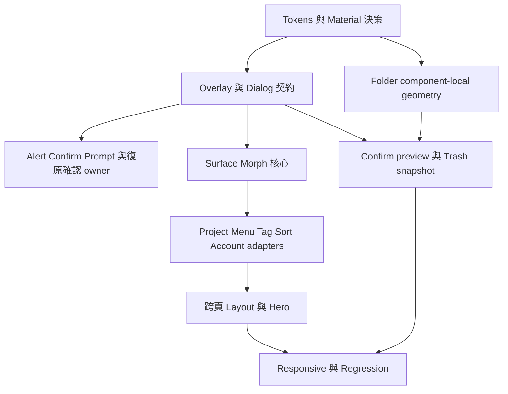

# 03｜共用元件與所有權

稽核日期：2026-11-11～2026-11-12（Asia/Taipei）。基準：本地目前工作區，含既有未提交 Landing 變更；不是 GitHub HEAD 的遠端部署稽核。

|Component|使用位置|現存 Variant／Context|問題與共用方向|預期修改檔案（本輪未改）|
|---|---|---|---|---|
|Button／IconButton|全站、sys、Template、Discovery|btn-primary / primary、hero-cta、card-apply、up-btn|高度38/40/44/48、focus/disabled 不同；統一 role/size/state|`public/css/components/button.css`、`public/css/style.css`|
|Input／Textarea|Auth、Generate、QC、Settings、editor|pill／rect／composer／key-input|保留語意差異；統一 label/help/error/focus contract|`public/css/components/input.css`、`public/css/auth.css`|
|Search|Projects、Template、Discovery|40px pill／寬 pill／表單欄位|統一搜尋語意、clear/loading/empty；容器寬度可不同|`public/js/pages/projects.js`、`public/js/pages/templates.js`|
|Dropdown／Popover|Project option、Projects tag/sort、QC more、Template native select|action menu／multi-select／single native|抽共用 motion/positioning，保留語意 adapter；內部8px角與pill期望不同|`public/js/components/project-option-morph.js`、`public/css/components/option-morph.css`|
|Alert／Confirm／Prompt|sys、ProjectActions、原生 rename|sys confirm／alert、native prompt|同一 DialogService；Promise 結果型別清楚；確認 owner 唯一|`public/js/sys.js`、`public/js/features/projects.js`|
|Modal／Drawer／Bottom Sheet|tags、shot editor、User Panel、template editor|自有overlay、sys-bg、project-editor|共用 OverlayManager、inert/focus/escape/layers，避免只統一CSS|`public/css/components/dialog.css`、`public/css/components/bottom-sheet.css`|
|Sidebar／AccountTrigger|AppShell、dashboard HTML|collapsed icon／expanded nav|footer只有div頭像；改為可鍵盤操作的account row|`public/js/shell/app-shell.js`、`public/css/dashboard.css`|
|Header／Toolbar|Projects、History、Template detail、Project detail|單列／雙列／editor-menubar|固定 slot contract；scroll owner 與 progressive edge 權責分離|`public/css/shell.css`、`public/js/dynamic-mask.js`|
|User Panel|Desktop Avatar、mobile Profile tab|desktop popover／mobile sheet|內容共用，布局有別；納入floating account variant|`public/js/shell/app-shell.js`、`public/css/dashboard.css`|
|Project Folder|Dashboard／Projects／History／Confirm|compact／default／deleted／clone|共用DOM已存在但幾何context外漏；改component local sizing|`public/js/components/project-card.js`、`public/css/components/project-card.css`|
|Tag／Badge／Chip|Folders、Template、Generate、Project detail|status／taxonomy／selection／spec|分開資訊badge與互動chip；文字/命中/selected不可混用|`public/css/components/badge.css`、`public/js/pages/projects.js`|
|Navigation|Sidebar、mobile nav、auth tabs、template tabs|links被當tabs／button混入tablist|routes用nav+aria-current；局部內容tabs才採roving tabindex|`public/js/shell/app-shell.js`、`public/css/components/mobile-nav.css`|
|Quick Create／Composer|global QC、Generate phase1|desktop capsule／mobile nav create／expanded field|入口共用brief；overlay語意、focus、escape與材料層級清楚|`public/js/components/quick-compose.js`、`public/css/generate.css`|
|Filmstrip／CoverTransition|Landing、Project detail、Project opening|展示film／可拖曳film／flying cover|共用視覺語彙而非同一DOM；pointer capture不可吞edit click|`public/js/components/project-cover-transition.js`、`public/js/project-detail.js`|
|Loading／Toast／Empty／Error|TransitionLoader、generation、Projects、Template|math curve／skeleton／toast／recovery|區分進度與ambient；錯誤可重試，資料空與載入失敗不可混淆|`public/js/components/transition-loader.js`、`public/js/components/global-toast.js`|
|Template timeline／Inspector|template detail advanced、template editor|overview／advanced／drawer|專業密度可例外；統一label/icon與focus，不強套Folder外觀|`public/js/template-timeline.js`、`public/css/template-editor.css`|

## Contract 應包含的內容

每個元件的規格需列：semantic role、anatomy slots、允許的 variant、尺寸與 material token、hover/active/focus/selected/disabled/busy/error、RWD、motion owner、mount/unmount、資料副作用 owner、測試入口。不能只列外觀 class。

Component＝Folder；Variant＝compact/default/preview/recycle；Context＝grid/reel/dialog；State＝hover/open/deleting/pending/failed。Context 只可決定可用 inline-size 與排列，不能決定 shell 形狀。

## 建議新增模組邊界（需先核准，尚未建立）

- `public/js/components/overlay-manager.js`：單一 top-layer owner、portal、outside/focus/escape/scroll lock、route signal teardown。
- `public/js/components/surface-morph.js`：共用幾何、timeline/interruption，不含任何 project CRUD。
- `public/js/components/dialog-service.js`：alert/confirm/prompt 三種内容契約；不覆蓋瀏覽器全域同名函式作長期架構。
- `project-option-morph.js`：保留 compatibility facade；Projects 的 `openSurface` 呼叫逐步改 adapter；User Panel 只接 account adapter。
- `ProjectCard.geometry`：render/measure/snapshot 三個接口；confirm preview 與 trash flight 依同一份 snapshot。
- `analysis/ui-audit/` 內的 mock 只作測試，不成為產品依賴。

## 已有資產應重用

ProjectCard 已共用 renderer；ProjectOptionMorph 已有 `openSurface`；Projects tag/sort 已使用它；ProjectDetail editor 已有 dialog role、焦點循環與 Escape；Landing 已有 matchMedia 清理；router 已有 AbortController 與 transition ownership。這些都是遷移起點，不能重做後造成新舊兩套長期並存。

## 依賴圖

