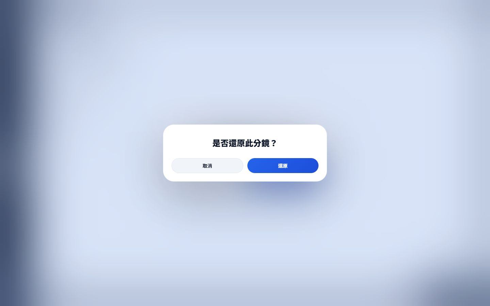
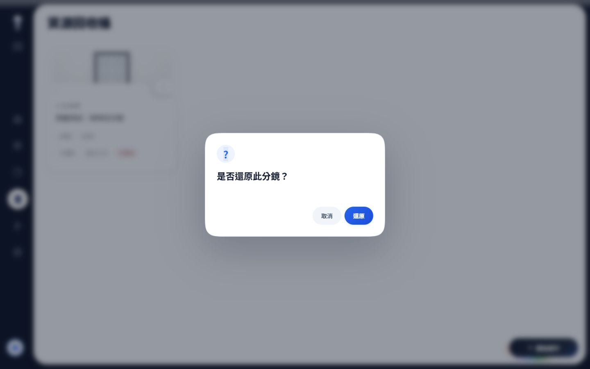
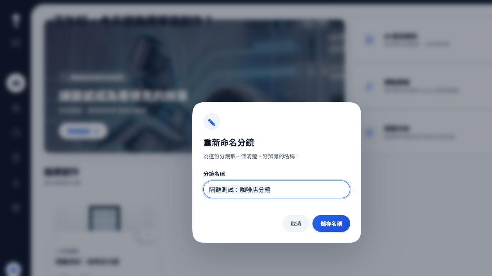

# Phase 1｜Dialog、重新命名、單次復原確認

日期：2026-11-12。已完成本階段實作與本地隔離驗證；未 Commit／Push，未進入 Phase2。依據 [Phase1 Handoff](../phase0/PHASE-1-HANDOFF.md)。既有未提交工作保留。

## 本次變更

- `DialogService` 提供 Alert／Confirm／Prompt 共用外框、標題、內容與Pill按鈕；Prompt有可見名稱label、預填、空白驗證、IME保護、busy防重送、失敗保留輸入並重試。
- `OverlayManager` 是Dialog限定的最小租約：背景inert、Tab循環、Escape、焦點回復、overflow狀態保存／還原。沒有接管QC、User Panel或Morph。
- `sys.js` 保留舊 `alert → Promise<void>`、`confirm → Promise<boolean>`；不覆蓋native prompt。Standalone載入sys的頁面可按需載入Service／helper，SPA則顯式載入。
- 回收桶Card只傳restore intent；`ProjectActions.restoreProject`為唯一確認owner，相同session／project在途操作共用Promise，取消零API、接受一次API、失敗rollback。
- 重新命名的API、trim／空白／同名規則與epoch保護沿用；Feature提供submit callback，Service不持有CRUD。Prompt的文字以textContent建立，沒有將專案名稱當HTML。
- PageHost僅增加一行傳入既有page signal；Router沒有修改。離頁取消Dialog／queue，不能讓舊視窗搶新頁焦點。

## 範圍保護

[來源驗證](source-verification.json) 比對Phase0的113檔清單，既有來源改動僅：dialog.css（保留原規則、追加scoped樣式）、sys.js、project-card-interactions.js、features/projects.js、page-host.js、index.html。另新增兩個JS module及測試。style.css已有Dialog import，未改動。

原有package.json、package-lock.json、Landing CSS／JS／animation的內容雜湊均保持Phase0值。index.html只插入兩個script；移除這兩行即可重建Phase0原始雜湊，既有修改沒有被覆蓋。

**Folder renderer／幾何CSS、Morph controller／CSS、Hero、Tokens、SPA Router均未改動。DeleteQueue及deleteProject action與原始碼區段完全一致**。刪除Confirm保留legacy clone／Trash視覺及1000ms關閉、1500ms接受時序，僅補modal lease、文案文字安全、重複點擊與abort清理；沒有實作跨頁五秒Undo。

## 測試與瀏覽器結果

[完整測試輸出](test-results.txt)：**96 passed，0 failed，0 skipped**。包含原四組、ModalAnimation、ProjectsFeature／ProjectsPage，以及新增Dialog生命週期、真async restore／rename、卡片不擁有confirm的案例。

```text
node --test tests/dialog-service.test.js tests/project-dialog-actions.test.js tests/project-card.test.js tests/project-card-interactions.test.js tests/project-option-morph.test.js tests/history-page.test.js tests/modal-animation.test.js tests/projects-feature.test.js tests/projects-page.test.js
```

[瀏覽器證據](browser-evidence.json) 為實際Chromium IAB操作；[SPA復原API紀錄](spa-restore-api-log.json)記錄一個restore POST。4318 fixture僅記憶體狀態，無正式server／資料庫／API代理。測試名稱、復原與錯誤均僅作用於fixture；真實使用者專案未操作。

|驗證項|結果／證據|
|---|---|
|新Prompt Desktop／Mobile|1440×900、390×844、375×812實際截圖；預填與空白inline error可見。|
|Rename失敗→重試|第一次PATCH503，輸入保留；重試成功，兩次request分屬一次失敗和一次成功。|
|Rename busy|延遲2秒fixture，cancel/submit停用，唯一次PATCH；同名與取消零PATCH另有單元測試。|
|Card復原雙擊|正式SPA History雙擊只出現一個dialog；取消後dialog數0，無殘留第二層。|
|Menu鍵盤復原|Enter開更多／還原選單、Enter接受；一次restore POST，History變空、Projects可見復原專案。|
|Restore取消／失敗|取消零POST；503後is_deleted回true並顯示Alert。失敗Alert是新錯誤通知，不是重複確認。|
|焦點／背景|實際ShiftTab由input到最後submit、Tab返回input；Escape關閉回更多按鈕。AX僅呈現modal內容；背景節點具有inert屬性。|
|Queue／abort|確認後依序顯示Alert，同時只有一個Dialog；Abort清除overlay/inert，結果為cancel。|
|SPA離頁|Projects Prompt填草稿後browser Back回History，dialog數0；未送PATCH、沒有舊視窗殘留。|
|IME|Browser fixture以CompositionEvent模擬：組字中Enter prevented、submit次數0；組字結束正常送出1次。非實體輸入法驗證。|
|Reduced Motion|隔離fixture固定matchMedia reduced分支，取消／cleanup正常；單元測試覆蓋無空間動畫時的完成結果。不是作業系統偏好／實機效能測試。|
|Delete相容|正式SPA Mock開啟1440／375 legacy Confirm並取消；單元假時計驗1499ms尚未接受、1500ms回true、1000ms發起關閉，以及取消退場中離頁釋放lease。|

## 前後截圖

原生Prompt在修改前已實際觀察為`dialog.type=prompt`並取消；IAB不能匯出該原生視窗畫面，因此**沒有偽造Prompt Before圖**。Before圖片沿用Phase0相同來源雜湊的實際截圖，來源與限制見 [截圖索引](SCREENSHOTS.md)。

|回收桶 Before：雙確認|After：單次確認|
|---|---|
|||

新命名Prompt：



## Gate／限制

- **已通過本輪實際範圍**：UI-01單次復原、UI-05自訂Prompt、Service普通Dialog的modal鍵盤／背景／清理、async結果相容、Desktop/Mobile視覺、相關96測試。詳見 [驗收紀錄](VERIFICATION.md)。
- **Pending Verification**：實體iOS/Android軟鍵盤與safe-area、Safari／Firefox、螢幕閱讀器、真實OS輸入法、實機幀率／性能trace、正式API環境。本輪不聲稱全站release gate或所有無障礙合格。
- UI-02 Folder preview錯形／可聚焦clone內容、Trash frame-based軌跡、跨頁Undo提前flush仍為Phase4問題，沒有以Phase1順手修改。User Panel、複雜shot editor與舊tag modal不在本次Service遷移範圍。
- 驗證用伺服器4317／4318已停止，viewport override已reset，測試tab已關閉。只留下文件、截圖、fixture及測試產物；不會自動繼續下一階段。
