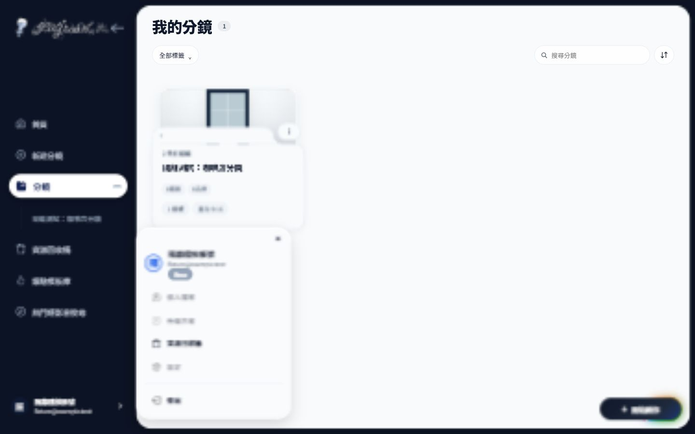
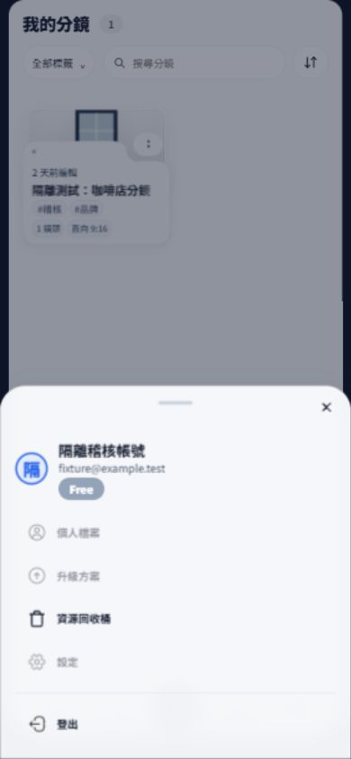

# Phase 3｜共用 Morph、Sidebar Account Row、User Panel

2026-11-13。依 Phase 0 的 C03／C05／C06 與已確認的 Phase 2 基線實作；本輪停止於 Phase 3，未 Commit／Push。

## 完成內容

- 抽出 `public/js/components/surface-morph.js`：幾何、480ms 開啟／440ms 關閉、單一 session、反向中斷、Portal、鍵盤與資源釋放。保留按鈕→圓點→拋物線→表面的品牌節奏。
- `project-option-morph.js` 成為內容與動作 Adapter。保留舊 API 與 ProjectActions 委派；Projects 的標籤多選、排序沿用同一引擎，維持 checkbox／radio 語意。
- OverlayManager 增加非 modal dismissal lease；捲動、Escape、outside pointer、焦點離開、signal、trigger 移除與可選尺寸觀察均由 lease dispose。內部捲動不關閉選單。
- Sidebar 頭像改為原生 Account Row button，固定 36px 頭像；展開時顯示帳號／實際 email／chevron。實測 1440px 下收合與展開的頭像 X 均為 22.796875px、寬均為 36px；按鈕高度至少 52px。
- User Panel 使用唯一內容 DOM。桌面為 320px anchored、non-modal dialog Morph；手機 ≤768px 為 modal Bottom Sheet，共享個人資訊、44px 膠囊操作與 Floating Surface 材質。
- 未提供帳號方案或 email 時隱藏欄位；未實作的個人檔案／升級／設定使用原生 disabled，不再顯示虛構會員資訊或無作用連結。實際存在的回收桶與登出保留。
- 登出沿用 Phase 1 DialogService，明確將 returnFocus 指向帳戶入口。回收桶沿用 Phase 2 SPA 導航與 History 隱藏 Bottom Nav。

## 實測後修正

1. 標籤選取會改變 trigger 寬度，原本新增的尺寸觀察會誤關閉多選選單；改為只有明確要求／帳戶 dialog 才觀察 trigger 尺寸。關閉時仍重新量測真實 trigger，瀏覽器多選重測通過。
2. 舊 `.up-body` 的對齊規則讓新 grid 收縮成 120px；明確定義單欄 `minmax(0, 1fr)` 與 stretch，恢復全寬膠囊操作。
3. Sidebar Account Row 原先繼承深色文字，改用 inverse text token。
4. resize handler 會在手機 modal 開啟期間改寫 Bottom Nav inert；現在 modal lease 存在時，Shell 不改寫該狀態。
5. 跨桌面／手機模式採關閉舊 presentation、焦點回到新模式入口，下一次點擊再開啟；避免 window 與 visualViewport 分別發送 resize 時產生重開競態。

## 範圍保護

保留原有未提交修改。開始時的來源副本與 SHA256 見 [baseline.json](baseline.json)／`before/`。本輪未改 Folder renderer、Folder interactions／CSS、Dashboard Hero、Undo Feature、SPA Router 或 Landing 動畫；10 個受保護來源的 SHA256 均與開始時一致，見 [source-verification.json](source-verification.json)。`dashboard.css` 亦未於本輪修改。

本輪產品修改：新增 `surface-morph.js`、`user-panel.js`、`account-panel.css`；整合 `overlay-manager.js`、`project-option-morph.js`、`app-shell.js`、`option-morph.css`、`style.css`、`index.html`。`pages/projects.js` 只補上離頁／焦點離開時不搶回焦點的 onClose 規則，保留先前頁面修改。

## 檢查與入口

- 測試結果與待驗證項目：[TESTING.md](TESTING.md)。
- 引擎／生命週期／遷移規則：[ARCHITECTURE.md](ARCHITECTURE.md)。
- 隔離驗證台：<http://127.0.0.1:4318/phase1-harness>。
- 桌面入口：<http://127.0.0.1:4318/phase2-visual?width=1440>；手機：<http://127.0.0.1:4318/phase2-visual?width=390>。沿用既有 QA host，點「登入隔離帳戶並開啟工作區」，再使用真正的帳戶按鈕。
- 服務未啟動時，在 repository 執行 `node analysis/ui-audit/phase1/mock-server.cjs`。`npm run audit:ui` 為既有別名，但本機全域 npm-cli 路徑目前失效，因此本輪以 node 直接執行測試。

截圖均為本地、記憶體 mock 資料，沒有操作正式刪除／Undo API。本輪沒有建立修改前的瀏覽器截圖，不以來源副本冒稱 before 圖。

