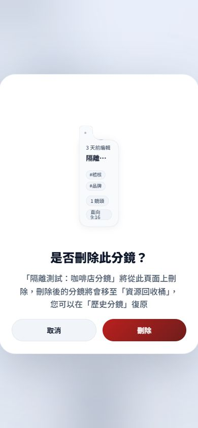
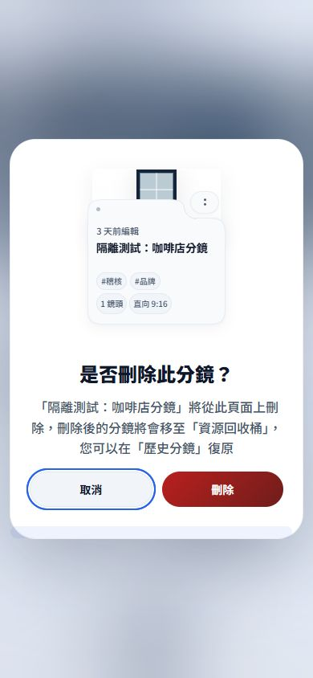

# Phase 4｜截圖與瀏覽器證據

**以下 after 是本輪實作中的真實瀏覽器擷取，不是最終版本簽核圖。** 最後的 136／176px Shell 校準、readonly option 隱藏／ambient、RAF 起算修正、帳戶透明材質板修改後，瀏覽器失去連線，尚未重新擷取。沒有使用其他 renderer 製造假瀏覽器圖。

## 修改前

相同記憶體 fixture、390／1440 CSS viewport，修改正式檔案前保存：

|範圍|390px|1440px|
|---|---|---|
|Dashboard|[before-dashboard-390.png](before-dashboard-390.png)|[before-dashboard-1440.png](before-dashboard-1440.png)|
|Projects|[before-projects-390.png](before-projects-390.png)|[before-projects-1440.png](before-projects-1440.png)|
|Delete confirm|[before-delete-390.png](before-delete-390.png)|[before-delete-1440.png](before-delete-1440.png)|

修改前 390px：Dashboard card 288.59375px、preview 276.59375×155.578125；Projects card 173px、preview 161×90.5625。原始數據：[before-geometry.json](before-geometry.json)。Delete 圖可見 narrow clone 與消失的封面；未在此階段真正確認刪除。

## 實作中

- [after-projects-390.png](after-projects-390.png)：共用 Folder 初版，兩行 title 空間、contain 封面、無外層 scale。
- [after-delete-390.png](after-delete-390.png)：使用相同 renderer 的真正 readonly preview；實測 preview 寬172px、高205.765625px、frame160×90px、互動元素數0。
- [trash-flight-390.png](trash-flight-390.png)：真正確認隔離刪除後，垃圾桶出現、按鈕 disabled 的實際畫面；不是完整逐幀錄影。
- [delete-api-log.json](delete-api-log.json)：此次只出現一筆 `/api/projects/audit-folder` DELETE，發生於記憶體 mock 4319；沒有正式資料庫操作。不能用此紀錄推論最終 motion clock 修正已完成瀏覽器回歸。
- [trash-trace-before-clock-fix.json](trash-trace-before-clock-fix.json)／`trash-trace-390.json`：**失敗調查證據，不列通過**。第一個 RAF 被延後約782ms，舊起算方式導致關窗時 flight 尚未完成，這是後續 timestamp／complete 修正的原因。

尚未取得 Dashboard 最終 after、1440 最終 after，以及最終帳戶 Morph 的前後圖；明列待補。

## 初版幾何量測

`geometry-375.json`、`geometry-390.json`、`geometry-1440.json` 是有效的初版三頁量測。390 下 Dashboard／Projects／History 寬172／173／173，Shell約133；1440 下三頁均寬316、高297、frame304×171。這些資料在最後136／176px校準前取得。

`geometry-768-invalid-harness.json`、`geometry-1024-invalid-harness.json` 的實際 reported width 是390，因早期 host 白名單退回預設值，**不當作768／1024驗證**。Host 已修正支援六尺寸並輸出實際 document clientWidth。修正後重測時發生 timeout，之後工具明確回報此對話本機瀏覽器不可用；768／1024／1920 均待驗證。

最後連線中斷也使暫時 viewport override 無法執行 reset；未聲稱已還原。

## 前後圖（實作中版本）

|修改前|實作中|
|---|---|
|||
